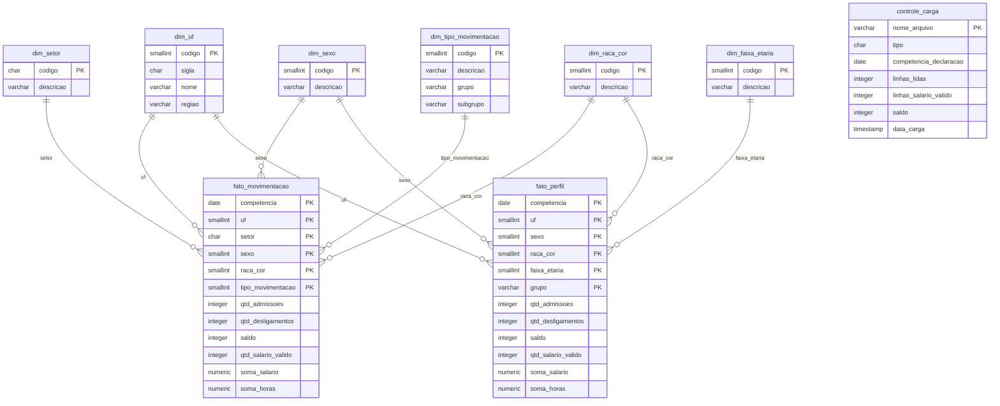

# Novo CAGED – Tratamento, modelagem e armazenamento em nuvem

Projeto da disciplina de Big Data e Analytics. Tema: **dinâmica do emprego formal e turnover setorial, com recortes por sexo e raça/cor** (ODS 5 e ODS 18).

Neste marco, os microdados públicos do Novo CAGED foram tratados, organizados em um modelo dimensional e carregados em um PostgreSQL gerenciado no Aiven. A infraestrutura está descrita em Terraform, e as credenciais ficam fora do repositório.

```
Microdados públicos do Novo CAGED (212 arquivos, 261,7 milhões de linhas)
↓
Tratamento em Python (leitura em blocos, limpeza, unificação MOV + FOR − EXC)
↓
Agregação em modelo dimensional (2 fatos, 6 dimensões, 1 tabela de controle)
↓
Carga no PostgreSQL do Aiven (2,19 milhões de linhas, 361 MB)
↓
Infraestrutura em Terraform e documentação versionadas neste repositório
```

---

## Estrutura do repositório

```
/
├── README.md                      ← esta documentação
├── infra/
│   └── terraform/                 ← infraestrutura como código (Aiven)
│       ├── versions.tf
│       ├── providers.tf
│       ├── variables.tf
│       ├── main.tf
│       ├── outputs.tf
│       ├── terraform.tfvars.example
│       ├── .gitignore
│       └── README.md
└── Tratamento/                    ← código e artefatos do tratamento
    ├── scripts/
    │   ├── config.py              ← parâmetros (anos, colunas, faixas, salário mínimo, banco)
    │   ├── tratar_dados.py        ← descompacta, lê em blocos, limpa e agrega
    │   ├── carregar_banco.py      ← cria tabelas, monta dimensões e carrega (ambiente local)
    │   ├── validar.py             ← confere totais, tamanhos e saldos
    │   └── main.py                ← executa tratamento, carga e validação em sequência
    ├── sql/
    │   ├── criar_tabelas.sql      ← DDL das 9 tabelas, com chaves e índices
    │   └── AUDITORIA_FINAL.sql    ← consultas de conferência da carga no Aiven
    ├── evidencias/                ← prints da carga, dos registros e da validação
    ├── importar_aiven.py          ← importação dos CSVs tratados no Aiven
    ├── RELATORIO_TECNICO_FASE_2.md
    ├── requirements.txt
    ├── .env.example               ← modelo de conexão, sem senha
    └── .gitignore
```

Ficam **fora do git**: os microdados originais (`BasesDados/`), os CSVs tratados (`saida/`), os arquivos temporários (`temp/`), o `.env` e os arquivos de estado e variáveis do Terraform.

---

## 1. Dados utilizados

### Fonte

Microdados do **Novo CAGED**, publicados pelo Ministério do Trabalho e Emprego (MTE) no PDET:
`ftp://ftp.mtps.gov.br/pdet/microdados/NOVO CAGED/`

### Identificação da base

O MTE publica três arquivos por mês:

| Arquivo | Conteúdo |
|---|---|
| `CAGEDMOV` | Movimentações (admissões e desligamentos) declaradas no prazo |
| `CAGEDFOR` | Movimentações declaradas fora do prazo |
| `CAGEDEXC` | Movimentações excluídas depois de declaradas |

### Período

**Janeiro de 2020 a dezembro de 2025** (72 competências).

### Características relevantes

| Tipo | Arquivos | Tamanho compactado | Linhas |
|---|---|---|---|
| MOV | 72 | 3.052,0 MB | 252.861.434 |
| FOR | 71 | 89,6 MB | 8.257.449 |
| EXC | 69 | 6,9 MB | 555.829 |
| **Total** | **212** | **3,1 GB** | **261.674.712** |

- Cada arquivo é um `.7z` com um `.txt` dentro, separado por `;`, em UTF-8 e com vírgula como separador decimal.
- Um arquivo MOV descompactado tem cerca de 400 MB e entre 2,1 e 4,4 milhões de linhas.
- Não há 72 arquivos FOR e EXC porque o Novo CAGED começou em janeiro de 2020: o FOR começa em 2020-02 e o EXC em 2020-04.
- A base não tem CPF, nome, PIS nem outro identificador de trabalhador ou empresa.

---

## 2. Tratamento realizado

O tratamento está em `Tratamento/scripts/tratar_dados.py`, com os parâmetros em `Tratamento/scripts/config.py`. Os arquivos originais nunca são alterados.

### Principais problemas identificados e decisões

| Problema ou característica | Decisão | Justificativa |
|---|---|---|
| Volume alto (até 4,4 milhões de linhas por mês) | Leitura em blocos de 500 mil linhas, só com as 10 colunas usadas | Processar sem depender da memória da máquina |
| O mês no nome do arquivo é o mês da **declaração**, não da movimentação | Agregar sempre pela coluna `competênciamov` | Atrasos e exclusões cairiam no mês errado |
| Três fontes (MOV, FOR, EXC) | Saldo = MOV + FOR − EXC, com as medidas do EXC multiplicadas por −1 | É a mesma lógica do saldo ajustado do MTE |
| Linhas idênticas | **Não** remover | Sem identificador do trabalhador, duas linhas iguais podem ser duas pessoas |
| Códigos vazios ou fora do layout | Classificar como "Não identificado" (UF 99, setor Z, sexo 9, raça/cor 9, tipo 99) | Descartar faria os totais divergirem dos oficiais |
| Salários zerados ou acima de R$ 20 milhões | Somar salários só entre 0,3 e 150 salários mínimos do ano; contar todos | Mesmo critério do MTE nos sumários do Novo CAGED |
| Idade vazia ou implausível | Faixa "Não identificado" fora de 14 a 100 anos (13.185 casos) | Preservar a contagem sem distorcer as faixas |
| 261,7 milhões de linhas | Guardar só contagens e somas por combinação de dimensões | Viabiliza o banco na nuvem e atende ao uso analítico |

### Transformações realizadas

- **Nomes de colunas:** minúsculas e sem acento (`competênciamov` → `competenciamov`, `raçacor` → `raca_cor`).
- **Tipos:** competência `202401` → data `2024-01-01`; salário e horas com vírgula → número; códigos → inteiros.
- **Faixa etária:** 14–17, 18–24, 25–29, 30–39, 40–49, 50–64 e 65+.
- **Salário mínimo por ano:** 1.045 (2020), 1.100 (2021), 1.212 (2022), 1.320 (2023), 1.412 (2024) e 1.518 (2025).
- **Admissões e desligamentos:** contados pelo sinal de `saldomovimentação` (+1 ou −1), como no saldo oficial.
- **Tipos de desligamento** agrupados para a análise de turnover:

| Subgrupo | Códigos | Movimentações |
|---|---|---|
| sem justa causa | 31 | 59.202.310 |
| a pedido | 40 | 41.531.163 |
| término de contrato | 43, 45 | 20.765.516 |
| justa causa | 32 | 2.268.946 |
| outros | 33, 50, 60, 80, 90, 98 | 2.003.518 |

O código 90 (acordo entre empregado e empregador) ficou em "outros" por não ser claramente voluntário nem involuntário.

- **Saída:** dois CSVs agregados por arquivo de origem, um para cada tabela fato, totalizando **424 CSVs (cerca de 0,26 GiB)**.

### Observações sobre a base

- Raça/cor tem duas categorias próximas no layout: "Não informada" (código 6, 41,4 milhões de movimentações, cerca de 16%) e "Não identificado" (código 9). As duas foram mantidas.
- A média salarial inclui vínculos intermitentes, que o MTE exclui. Pode haver pequena diferença em relação à média oficial.

---

## 3. Modelagem

### Estratégia

Modelo **dimensional** (esquema estrela) no schema `public`: duas tabelas fato, seis dimensões e uma tabela de controle de carga. As medidas são aditivas (contagens e somas), então médias como salário médio e salário por hora são calculadas por divisão no consumo.

### Por que duas tabelas fato

Uma única tabela com todas as dimensões geraria cerca de 267 mil linhas por mês, ou 19 milhões em 72 meses, mais de 1 GB sem contar índices. Por isso os dados foram separados por grão:

- **`fato_movimentacao`**: competência × UF × setor × sexo × raça/cor × tipo de movimentação. É o centro do tema (turnover setorial por gênero e raça).
- **`fato_perfil`**: competência × UF × sexo × raça/cor × faixa etária × grupo (admissão ou desligamento). Atende ao filtro de idade sem multiplicar o tamanho.

As duas saem da mesma leitura e têm os mesmos totais. A contrapartida é que **não é possível cruzar faixa etária com setor**. A escolaridade foi deixada de fora por ser a dimensão que mais aumentava o volume e a menos ligada ao recorte.

A coluna `origem` (MOV, FOR, EXC) foi retirada da chave, porque quase dobrava as linhas. O fato guarda o valor já ajustado, e o saldo sem ajuste de cada mês fica na `controle_carga`.

### Diagrama



### Tabelas e volume

| Tabela | Função | Linhas | Tamanho (com índices) |
|---|---|---|---|
| `fato_movimentacao` | Métricas por competência, UF, setor, sexo, raça/cor e tipo | 1.875.754 | 293 MB |
| `fato_perfil` | Métricas por competência, UF, sexo, raça/cor, faixa etária e grupo | 312.896 | 60 MB |
| `controle_carga` | Um registro por arquivo de origem (rastreabilidade) | 212 | 56 kB |
| `dim_uf` | UFs, com sigla e região | 28 | 24 kB |
| `dim_setor` | Seções da CNAE 2.0 | 22 | 24 kB |
| `dim_sexo` | Categorias de sexo | 3 | 24 kB |
| `dim_raca_cor` | Categorias de raça/cor | 7 | 24 kB |
| `dim_faixa_etaria` | Faixas de idade | 8 | 24 kB |
| `dim_tipo_movimentacao` | Tipos, grupos e subgrupos de movimentação | 18 | 24 kB |

**Medidas das tabelas fato:** `qtd_admissoes`, `qtd_desligamentos`, `saldo`, `qtd_salario_valido` (INTEGER), `soma_salario` e `soma_horas` (NUMERIC(18,2)).

O DDL completo, com chaves primárias, estrangeiras e índices, está em `Tratamento/sql/criar_tabelas.sql`.

---

## 4. Infraestrutura

### Serviços utilizados

| Item | Valor |
|---|---|
| Provedor | Aiven (PostgreSQL gerenciado) |
| Serviço | `pg-374a1585`, no projeto `ucsal-e322` |
| Banco | PostgreSQL 18, banco `defaultdb`, schema `public` |
| Plano | Developer (`developer-1`): 1 CPU, 1 GB de RAM, 8 GB de armazenamento |
| Nuvem e região | DigitalOcean, Nova York (`do-nyc`) |
| Conexão | SSL obrigatório (`sslmode=require`) |

O banco ocupa **361 MB** de tamanho lógico (`pg_database_size`), cerca de 11% do armazenamento do plano segundo o painel do Aiven.

### Recursos provisionados

A pasta `infra/terraform/` descreve o serviço PostgreSQL como código, com o provider oficial `aiven/aiven`:

| Arquivo | Conteúdo |
|---|---|
| `main.tf` | Recurso `aiven_pg` (o serviço), com `prevent_destroy` para impedir exclusão acidental |
| `variables.tf` | Projeto, nome do serviço, plano e nuvem |
| `providers.tf` | Autenticação no Aiven pelo token em variável de ambiente |
| `outputs.tf` | Host, porta e URI de conexão, marcados como sensíveis |
| `versions.tf` | Versões do Terraform (≥ 1.5) e do provider (4.x) |

O serviço foi criado inicialmente pelo console do Aiven e depois **importado** para o Terraform (`terraform import`). O `terraform plan` retornou "No changes", confirmando que o código representa exatamente o serviço em uso. As tabelas são criadas pelo `criar_tabelas.sql`, separadas da infraestrutura para que uma alteração no Terraform nunca recrie ou apague os dados.

### Tecnologias empregadas

- **Python 3** com pandas, SQLAlchemy, psycopg2, python-dotenv e py7zr
- **PostgreSQL** (DDL, chaves, índices e consultas de auditoria)
- **Terraform** com o provider `aiven/aiven`
- **Git e GitHub** para versionamento

---

## 5. Segurança das informações

Nenhuma credencial, senha, token ou chave está no repositório. A estratégia é:

| Informação | Onde fica | Como é protegida |
|---|---|---|
| Usuário e senha do banco | Arquivo `.env`, só na máquina de quem executa | `.env` no `.gitignore`; o repositório tem só o `.env.example`, sem valores |
| Token da API do Aiven | Variável de ambiente `TF_VAR_aiven_api_token` | Não fica em nenhum arquivo; variável marcada como `sensitive` no Terraform |
| Valores reais do Terraform | `terraform.tfvars`, só local | No `.gitignore`; o repositório tem o `terraform.tfvars.example` |
| Estado do Terraform (contém a senha do banco) | `terraform.tfstate`, só local | `*.tfstate` no `.gitignore` |
| Dados de conexão gerados | Saídas do Terraform | Marcadas como `sensitive`, não aparecem no terminal |

Outras medidas:

- **Conexão criptografada:** o Aiven exige SSL em todas as conexões.
- **Proteção contra exclusão:** `prevent_destroy` no Terraform e bloqueio no `importar_aiven.py` contra carga duplicada.
- **Histórico verificado:** o histórico do git foi conferido e não contém senhas nem tokens.
- **Tokens temporários:** o token do Aiven é gerado para a execução e revogado depois.
- **LGPD:** a base pública não tem identificadores de pessoas ou empresas, e o banco recebe apenas contagens e somas agregadas, nunca registros individuais.

---

## 6. Base de dados tratada

- **No banco:** a base tratada está carregada no PostgreSQL do Aiven (`defaultdb`), nas tabelas descritas na seção 3.
- **Em arquivos:** os 424 CSVs agregados (cerca de 0,26 GiB) não estão no git por causa do tamanho. Estão disponíveis em: **[inserir link]**
- **Reprodução:** podem ser gerados novamente a partir dos microdados públicos, seguindo a seção 7.

---

## 7. Execução

### Ferramentas e dependências

- Python 3 e as bibliotecas de `Tratamento/requirements.txt`
- Terraform 1.5 ou superior
- Conta no Aiven, com um token de API
- Microdados do Novo CAGED baixados do PDET na pasta `BasesDados/`, ao lado da pasta `Tratamento/`

### Sequência de execução

**1. Infraestrutura (Terraform)**

```powershell
cd infra/terraform
$env:TF_VAR_aiven_api_token = "SEU_TOKEN"
copy terraform.tfvars.example terraform.tfvars   # preencher com os dados do Aiven
terraform init
terraform plan
terraform apply                                   # só em um ambiente novo
```

No ambiente atual, que já existe, o serviço foi importado com `terraform import aiven_pg.caged ucsal-e322/pg-374a1585`, e o `plan` deve mostrar "No changes". Detalhes em `infra/terraform/README.md`.

**2. Configuração da conexão**

```powershell
cd Tratamento
copy .env.example .env      # preencher host, porta, banco, usuário e senha do Aiven
pip install -r requirements.txt
```

**3. Tratamento dos dados**

```powershell
python scripts/tratar_dados.py
```

Gera os CSVs agregados em `saida/`. Se for interrompido, basta rodar de novo: os arquivos já tratados são pulados. Para testar com um mês, altere `COMPETENCIAS_TESTE = ["202401"]` no `config.py`.

**4. Criação das tabelas e das dimensões**

Executar `sql/criar_tabelas.sql` no banco e carregar as dimensões. **Atenção:** esse SQL contém `DROP TABLE` e nunca deve ser executado em um banco já populado.

**5. Carga no Aiven**

```powershell
python importar_aiven.py
```

O importador se recusa a rodar se as tabelas fato ou a `controle_carga` já tiverem dados, para evitar duplicação.

**6. Validação**

Executar as consultas de `sql/AUDITORIA_FINAL.sql` e, se quiser, `python scripts/validar.py`.

Tempos de referência: tratamento dos 212 arquivos em cerca de 25 minutos e carga em cerca de 7 minutos.

> **Execução local alternativa:** `python scripts/main.py` cria um banco local `BigData`, trata os arquivos, carrega e valida em sequência. Foi usado no desenvolvimento.

> **Problema conhecido no Windows 11:** o Controle de Aplicativo pode bloquear as DLLs do SQLAlchemy. Solução:
> ```powershell
> $env:DISABLE_SQLALCHEMY_CEXT = "1"
> pip install --force-reinstall --no-deps --no-binary sqlalchemy sqlalchemy
> ```

---

## 8. Validação

**Integridade:** a soma de admissões e desligamentos no fato é 260.563.054, exatamente 252.861.434 (MOV) + 8.257.449 (FOR) − 555.829 (EXC). Por arquivo, as linhas lidas bateram com as linhas contadas após a agregação. As duas tabelas fato têm os mesmos totais: 134.791.601 admissões, 125.771.453 desligamentos e saldo de 9.020.148.

**Auditoria no Aiven:** zero competências nulas, zero saldos diferentes de admissões menos desligamentos e zero UFs sem correspondência na dimensão. Período de 2020-01 a 2025-12 nas duas tabelas fato.

**Comparação com o MTE (saldo sem ajuste):**

| Competência | Nosso saldo | Oficial MTE | Diferença |
|---|---|---|---|
| 2020-01 | 92.678 | 92.678 | 0 |
| 2021-01 | 257.059 | 257.059 | 0 |
| 2021-06 | 310.036 | 309.114 | +922 |
| 2022-01 | 155.178 | 155.178 | 0 |
| 2023-01 | 83.297 | 83.297 | 0 |
| 2023-03 | 195.171 | 195.171 | 0 |
| 2024-01 | 180.395 | 180.395 | 0 |
| 2025-01 | 137.303 | 137.303 | 0 |

A diferença de junho de 2021 se explica pela republicação dos microdados pelo MTE em outubro de 2021. O número oficial comparado é o divulgado em julho de 2021.

**Saldo com ajuste (MOV + FOR − EXC):**

| Competência | Nosso saldo | Oficial MTE | Diferença |
|---|---|---|---|
| 2020-01 | 112.114 | 112.110 | +4 |
| 2021-01 | 254.489 | 254.493 | −4 |
| 2022-01 | 167.404 | 167.413 | −9 |
| 2023-01 | 90.090 | 90.102 | −12 |
| 2024-01 | 173.105 | 173.127 | −22 |
| 2025-01 | 152.651 | 154.396 | −1.745 |

O valor oficial considera ajustes declarados até janeiro de 2026, e os nossos arquivos vão até dezembro de 2025. Por isso os meses mais recentes, especialmente 2025, ainda estão menos ajustados.

Os prints da carga e da validação estão em `Tratamento/evidencias/`.

---

## 9. Resumo das decisões técnicas

| Decisão | Alternativa descartada | Motivo |
|---|---|---|
| Python com pandas em blocos | Carregar arquivos inteiros | Arquivos de até 4,4 milhões de linhas por mês |
| Agregação antes da carga | Guardar os microdados linha a linha | 261,7 milhões de linhas; o uso é analítico, não individual |
| Modelo dimensional com duas tabelas fato | Uma tabela fato com todas as dimensões | Uma única tabela passaria de 19 milhões de linhas |
| Unificar MOV + FOR − EXC na mesma linha | Guardar a origem na chave | Quase dobrava o número de linhas |
| PostgreSQL gerenciado no Aiven | Banco local ou máquina virtual própria | Banco na nuvem sem administrar servidor |
| Terraform com import do serviço existente | Recriar o serviço do zero | Preserva os dados já carregados |
| Tabelas fora do Terraform (SQL próprio) | Criar tabelas pelo Terraform | Evita que uma mudança de infraestrutura apague os dados |
| Credenciais em `.env` e variáveis de ambiente | Credenciais no código | Nenhum segredo no repositório público |

---

## 10. Limitações

- Não é possível cruzar faixa etária com setor nem analisar escolaridade.
- Os meses mais recentes ainda vão receber declarações atrasadas e exclusões do MTE.
- A média salarial inclui vínculos intermitentes, ao contrário da média oficial.
- O salário mínimo usado no filtro é um valor por ano, sem as mudanças dentro do ano.

Mais detalhes em `Tratamento/RELATORIO_TECNICO_FASE_2.md`.
