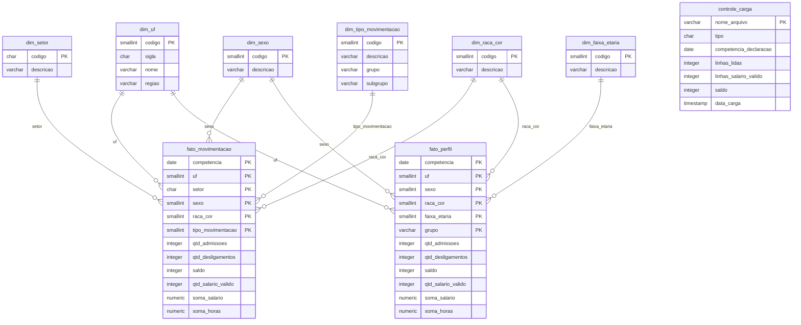

# Fase 2 – Tratamento e armazenamento dos dados do Novo CAGED

Projeto da disciplina de Big Data e Analytics. Tema: dinâmica de emprego formal e turnover setorial, com recorte de gênero e raça/cor (ODS 5 e ODS 18).

Este documento descreve de onde vieram os dados, como foram tratados, como ficaram guardados no PostgreSQL (banco `BigData`) e como rodar o processo de novo.

## 1. Origem dos dados

Usamos os microdados do Novo CAGED, publicados pelo Ministério do Trabalho e Emprego no PDET (`ftp://ftp.mtps.gov.br/pdet/microdados/NOVO CAGED/`). O período é de janeiro de 2020 a dezembro de 2025.

O MTE publica três arquivos por mês:

- `CAGEDMOV`: movimentações (admissões e desligamentos) declaradas dentro do prazo;
- `CAGEDFOR`: movimentações declaradas fora do prazo;
- `CAGEDEXC`: movimentações que foram excluídas depois de declaradas.

Baixamos 212 arquivos, todos em `.7z`, com um `.txt` dentro de cada um. No total são 3,1 GB compactados.

| Tipo | Arquivos | Tamanho compactado |
|---|---|---|
| MOV | 72 | 3.052,0 MB |
| FOR | 71 | 89,6 MB |
| EXC | 69 | 6,9 MB |

Não existem 72 arquivos de FOR e de EXC porque o Novo CAGED começou em janeiro de 2020: no primeiro mês ainda não havia declaração atrasada (o FOR começa em 2020-02) e as exclusões só aparecem a partir de 2020-04.

Os arquivos originais ficam na pasta `BasesDados`, ao lado desta, e não são alterados em nenhum momento. O processo só lê.

Cada `.txt` usa `;` como separador, encoding UTF-8 e vírgula como separador decimal. Um arquivo MOV descompactado tem perto de 400 MB e entre 2,1 e 4,4 milhões de linhas.

## 2. Como os dados foram tratados

### Leitura em pedaços

Um mês de MOV tem quase 4 milhões de linhas, e são 72 meses. Para não depender de memória, lemos cada arquivo com `pandas.read_csv(..., chunksize=500000)`, carregando só as 10 colunas que usamos (`usecols`). Cada pedaço é limpo e agregado com `groupby`, e no final somamos os resultados dos pedaços. Cada arquivo é descompactado na pasta `temp/`, lido e apagado em seguida.

### Nomes de colunas e tipos

Os nomes originais têm acento e vêm colados (`competênciamov`, `raçacor`, `tipomovimentação`). Renomeamos para minúsculas sem acento: `competenciamov`, `raca_cor`, `tipo_movimentacao`, `setor` (a seção da CNAE) e assim por diante.

Lemos tudo como texto e convertemos na mão, para ter controle sobre o que acontece com valores estranhos:

- a competência (`202401`) vira data no primeiro dia do mês (`2024-01-01`);
- salário e horas contratuais têm a vírgula trocada por ponto e viram número;
- os códigos (UF, sexo, raça/cor, tipo de movimentação) viram inteiros.

### Unificação de MOV, FOR e EXC

Aqui apareceu o primeiro problema. Achávamos que o mês no nome do arquivo era o mês da movimentação, mas não é: é o mês em que a declaração foi feita. O `CAGEDFOR202401`, por exemplo, só tem movimentações de 2023, e o `CAGEDEXC202401` tem exclusões de movimentações de 2020 até 2023. Se usássemos o nome do arquivo, os atrasos e as exclusões cairiam no mês errado.

Por isso agregamos sempre pela coluna `competênciamov`, que é a competência da movimentação. O saldo de um mês fica sendo o que foi declarado no prazo, mais o que chegou atrasado, menos o que foi excluído. Nos arquivos de exclusão a movimentação vem com o sinal original, então multiplicamos todas as medidas por −1 para que ela subtraia do que já tinha sido contado.

### Linhas duplicadas

Não removemos linhas iguais. O microdado público não tem identificador do trabalhador, então duas linhas idênticas podem ser duas pessoas diferentes, com a mesma idade e o mesmo salário, admitidas na mesma empresa. Apagar duplicatas apagaria admissões reais.

O risco de duplicidade que existe de verdade é carregar o mesmo arquivo duas vezes. Evitamos isso de duas formas: o tratamento pula o arquivo que já tem CSV na pasta `saida/`, e a carga apaga e recria as tabelas antes de inserir. Rodar o processo duas vezes dá o mesmo resultado.

### Nulos e códigos inválidos

Nenhuma linha é descartada. Quando um código vem vazio, ou não existe no layout do MTE, ele vai para a categoria "Não identificado" que o próprio layout já tem (UF 99, setor Z, sexo 9, raça/cor 9, tipo 99). Se descartássemos essas linhas, nossos totais não bateriam com os números oficiais.

Na prática o único campo com vazios foi a idade. Vale registrar que em raça/cor existem duas categorias parecidas no layout, "Não informada" (código 6) e "Não identificado" (código 9), e mantivemos as duas como vieram. A "Não informada" tem 41,4 milhões de movimentações, cerca de 16% do total, o que precisa ser levado em conta na análise por raça.

### Faixa etária

Criamos a faixa a partir da idade: 14 a 17, 18 a 24, 25 a 29, 30 a 39, 40 a 49, 50 a 64 e 65 ou mais. Idade vazia ou fora do intervalo de 14 a 100 anos vai para "Não identificado". Isso aconteceu em 13.185 movimentações.

### Salário

Todas as movimentações entram nas contagens, com qualquer salário. Mas na soma dos salários, que serve para calcular a média, só entram valores entre 0,3 e 150 salários mínimos do ano da movimentação. Há salários declarados como zero e outros acima de 20 milhões, e eles distorceriam a média. O critério é o que o MTE usa nos sumários executivos do Novo CAGED ("não incluem valores menores que 0,3 salários mínimos e maiores que 150 salários mínimos").

Usamos um salário mínimo por ano: 1.045 (2020), 1.100 (2021), 1.212 (2022), 1.320 (2023), 1.412 (2024) e 1.518 (2025). Nos meses em que o valor oficial era outro (1.039 em janeiro de 2020 e 1.302 de janeiro a abril de 2023), a diferença é pequena demais para mudar o filtro.

Dos 252,9 milhões de linhas dos arquivos MOV, 247,8 milhões (98%) têm salário dentro da faixa.

Guardamos a quantidade de salários válidos, a soma dos salários e a soma das horas contratuais desses mesmos registros. Assim a média salarial e o salário por hora saem por divisão no dashboard.

Uma limitação: o MTE também tira os vínculos intermitentes do cálculo do salário médio, e nós não tiramos. Nossa média salarial pode ficar um pouco diferente da oficial por causa disso.

### Tipo de movimentação

Para contar admissões e desligamentos usamos o sinal da coluna `saldomovimentação` (+1 ou −1), que é como o saldo oficial é calculado.

Além disso, cada tipo de movimentação do layout recebeu um grupo (admissão ou desligamento) e os desligamentos receberam um subgrupo, para a análise de turnover voluntário e involuntário:

| Subgrupo | Códigos | Movimentações |
|---|---|---|
| sem justa causa | 31 | 59.202.310 |
| a pedido | 40 | 41.531.163 |
| término de contrato | 43, 45 | 20.765.516 |
| justa causa | 32 | 2.268.946 |
| outros | 33, 50, 60, 80, 90, 98 | 2.003.518 |

O código 90 (desligamento por acordo entre empregado e empregador) ficou em "outros", porque não é claramente voluntário nem involuntário. Também estão em "outros" aposentadoria, morte, culpa recíproca, transferência e tipo ignorado.

### Agregação

O banco vai ser migrado para o plano gratuito do Aiven, que tem limite de 1 GB. Os microdados têm 261,7 milhões de linhas, então não dava para guardar linha a linha. O que vai para o banco são contagens e somas por combinação de dimensões.

## 3. Antes e depois

| Arquivos originais | Linhas lidas |
|---|---|
| MOV (72 arquivos) | 252.861.434 |
| FOR (71 arquivos) | 8.257.449 |
| EXC (69 arquivos) | 555.829 |
| Total | 261.674.712 |

| Tabela no banco | Linhas |
|---|---|
| fato_movimentacao | 1.875.754 |
| fato_perfil | 312.896 |
| controle_carga | 212 |
| dimensões (6 tabelas) | 86 |

Para conferir que nada se perdeu: a soma de admissões e desligamentos no fato é 260.563.054, que é exatamente 252.861.434 + 8.257.449 − 555.829. O tratamento também compara, arquivo por arquivo, o número de linhas lidas com o número de linhas contadas depois da agregação, e não houve nenhuma diferença.

O tratamento dos 212 arquivos levou cerca de 25 minutos e a carga no banco mais uns 7.

## 4. LGPD

Verificamos as colunas dos três tipos de arquivo e nenhuma delas tem CPF, nome, PIS ou qualquer outro identificador do trabalhador ou da empresa. Mesmo assim, o banco não recebe nenhum registro individual: só contagens e somas agregadas por mês, UF, setor e perfil.

## 5. Modelo do banco

Usamos um modelo estrela no schema `public` do banco `BigData`, com duas tabelas fato, seis dimensões e uma tabela de controle.



### Por que duas tabelas fato

A ideia inicial era uma tabela só, com todas as dimensões: competência, UF, setor, sexo, raça/cor, faixa etária, escolaridade e tipo de movimentação. Antes de escrever o código, medimos quantas combinações isso dava em um mês (janeiro de 2024) e o resultado foi 267 mil linhas. Em 72 meses seriam uns 19 milhões de linhas, mais de 1 GB só de dados, sem contar os índices. Não cabia no Aiven.

Testamos tirar dimensões. Escolaridade e faixa etária eram as que mais multiplicavam as linhas. A solução foi dividir:

- `fato_movimentacao` guarda o detalhe por setor e tipo de movimentação, que é o centro do tema (turnover setorial por gênero e raça);
- `fato_perfil` guarda a faixa etária, que o dashboard precisa como filtro, mas sem setor e sem o tipo detalhado (só admissão ou desligamento).

As duas saem da mesma leitura dos arquivos e têm os mesmos totais. A limitação é que não dá para cruzar faixa etária com setor.

A escolaridade ficou de fora das duas. Era a dimensão que mais aumentava o tamanho e a menos ligada ao recorte do trabalho.

### Por que `origem` não está na chave

Na primeira versão, o fato tinha uma coluna `origem` (MOV, FOR ou EXC) na chave. Isso permitia ver o saldo sem ajuste e com ajuste na mesma tabela, mas quase dobrava o número de linhas, porque cada combinação aparecia uma vez para cada origem.

Tiramos a coluna e passamos a somar MOV + FOR − EXC na mesma linha. O fato guarda o valor já ajustado. Para não perder o saldo sem ajuste, que é o número que o MTE divulga no mês, ele ficou guardado na `controle_carga`: o saldo do arquivo MOV de cada mês.

### Tabelas

`dim_uf` (28 linhas): `codigo` SMALLINT, chave primária, código IBGE da UF, com 99 para não identificado; `sigla` CHAR(2); `nome` VARCHAR(50); `regiao` VARCHAR(20). Código e nome vêm do layout do MTE. Sigla e região foram acrescentadas por nós, a região a partir do primeiro dígito do código.

`dim_setor` (22 linhas): `codigo` CHAR(1), chave primária, seção da CNAE 2.0 de A a U, com Z para não identificado; `descricao` VARCHAR(100).

`dim_sexo` (3 linhas): `codigo` SMALLINT, chave primária (1 homem, 3 mulher, 9 não identificado); `descricao` VARCHAR(30).

`dim_raca_cor` (7 linhas): `codigo` SMALLINT, chave primária (1 branca, 2 preta, 3 parda, 4 amarela, 5 indígena, 6 não informada, 9 não identificado); `descricao` VARCHAR(30).

`dim_faixa_etaria` (8 linhas): `codigo` SMALLINT, chave primária (1 a 7 para as faixas, 99 para não identificado); `descricao` VARCHAR(30).

`dim_tipo_movimentacao` (18 linhas): `codigo` SMALLINT, chave primária; `descricao` VARCHAR(100), do layout; `grupo` VARCHAR(20), que é Admissão, Desligamento ou Não identificado; `subgrupo` VARCHAR(30).

`fato_movimentacao` (1.875.754 linhas): uma linha por competência, UF, setor, sexo, raça/cor e tipo de movimentação. A chave primária é composta por essas seis colunas. `uf`, `setor`, `sexo`, `raca_cor` e `tipo_movimentacao` são chaves estrangeiras para as dimensões. Há índices simples em `uf`, `setor` e `tipo_movimentacao`.

`fato_perfil` (312.896 linhas): uma linha por competência, UF, sexo, raça/cor, faixa etária e grupo. A chave primária é composta por essas seis colunas. `uf`, `sexo`, `raca_cor` e `faixa_etaria` são chaves estrangeiras. `grupo` é VARCHAR(12) e só aceita "Admissão" ou "Desligamento". Há índices simples em `uf` e `faixa_etaria`.

As medidas são iguais nas duas tabelas fato:

| Campo | Tipo | Significado |
|---|---|---|
| competencia | DATE | primeiro dia do mês da movimentação |
| qtd_admissoes | INTEGER | número de admissões |
| qtd_desligamentos | INTEGER | número de desligamentos |
| saldo | INTEGER | admissões menos desligamentos |
| qtd_salario_valido | INTEGER | registros com salário entre 0,3 e 150 salários mínimos |
| soma_salario | NUMERIC(18,2) | soma dos salários válidos |
| soma_horas | NUMERIC(18,2) | soma das horas contratuais dos registros com salário válido |

Como os valores já descontam as exclusões, algumas poucas linhas podem ter contagem zero ou negativa, quando uma combinação só apareceu em arquivos de exclusão. Nos totais por mês isso se compensa.

### Para que serve a `controle_carga`

Ela tem uma linha para cada um dos 212 arquivos originais: `nome_arquivo` (chave primária), `tipo` (MOV, FOR ou EXC), `competencia_declaracao` (o mês do nome do arquivo), `linhas_lidas`, `linhas_salario_valido`, `saldo` e `data_carga`.

É ela que liga o banco aos arquivos de origem. Dá para ver exatamente quais arquivos entraram, quantas linhas cada um tinha e quando foram carregados. O `saldo` dos arquivos MOV é o saldo sem ajuste de cada mês. Nos arquivos EXC, o saldo já está com o sinal invertido.

## 6. Quantidade de dados armazenados

| Tabela | Linhas | Tamanho (com índices) |
|---|---|---|
| fato_movimentacao | 1.875.754 | 229,22 MB |
| fato_perfil | 312.896 | 44,16 MB |
| controle_carga | 212 | 0,05 MB |
| dim_uf | 28 | 0,02 MB |
| dim_setor | 22 | 0,02 MB |
| dim_sexo | 3 | 0,02 MB |
| dim_raca_cor | 7 | 0,02 MB |
| dim_faixa_etaria | 8 | 0,02 MB |
| dim_tipo_movimentacao | 18 | 0,02 MB |
| Total das tabelas | | 273,58 MB |

O banco inteiro, contando o catálogo do PostgreSQL, ocupa 281,64 MB (`pg_database_size`). Fica com folga dentro do limite de 1 GB, então mantivemos os índices.

## 7. Validação

Comparamos o saldo nacional do nosso banco com os números do MTE. Os valores oficiais dos meses de janeiro vieram da apresentação "Estatísticas Mensais do Emprego Formal – Novo Caged" de janeiro de 2026, que traz a série de janeiros sem ajuste e com ajuste. Para junho de 2021 e março de 2023 usamos o saldo divulgado na época.

Saldo sem ajuste (só o arquivo MOV do mês):

| Competência | Nosso saldo | Oficial MTE | Diferença |
|---|---|---|---|
| 2020-01 | 92.678 | 92.678 | 0 |
| 2021-01 | 257.059 | 257.059 | 0 |
| 2021-06 | 310.036 | 309.114 | +922 |
| 2022-01 | 155.178 | 155.178 | 0 |
| 2023-01 | 83.297 | 83.297 | 0 |
| 2023-03 | 195.171 | 195.171 | 0 |
| 2024-01 | 180.395 | 180.395 | 0 |
| 2025-01 | 137.303 | 137.303 | 0 |

Sete dos oito meses bateram exatamente. Em janeiro de 2024 também conferimos admissões (2.067.817) e desligamentos (1.887.422) do arquivo MOV, e os dois bateram com o divulgado.

A diferença em junho de 2021 tem explicação. O número 309.114 foi divulgado em julho de 2021. Em outubro de 2021 o MTE mudou a forma de consolidar as fontes do Novo CAGED e republicou os microdados desde janeiro de 2020 (isso está no documento "Sobre o Novo Caged", que acompanha os arquivos). Nós usamos os arquivos republicados, então o saldo daquele mês não é mais o que saiu na imprensa na época. A diferença é de 0,3%.

Saldo com ajuste (MOV + FOR − EXC, o que está no fato):

| Competência | Nosso saldo | Oficial MTE | Diferença |
|---|---|---|---|
| 2020-01 | 112.114 | 112.110 | +4 |
| 2021-01 | 254.489 | 254.493 | −4 |
| 2022-01 | 167.404 | 167.413 | −9 |
| 2023-01 | 90.090 | 90.102 | −12 |
| 2024-01 | 173.105 | 173.127 | −22 |
| 2025-01 | 152.651 | 154.396 | −1.745 |

Aqui nenhum mês bate exatamente, e não era para bater. O número oficial considera os ajustes declarados até janeiro de 2026, e os nossos arquivos vão até dezembro de 2025. Falta para nós um mês de declarações atrasadas e exclusões. Para os anos mais antigos isso dá diferença de poucas unidades. Para janeiro de 2025 a diferença é maior (1,1%), porque meses recentes ainda recebem bastante declaração atrasada. Não temos o arquivo de janeiro de 2026 para confirmar que a diferença vem toda daí, mas o tamanho e o padrão das diferenças são compatíveis com essa explicação.

Pelo mesmo motivo, os últimos meses de 2025 ainda estão pouco ajustados no nosso banco. Dezembro de 2025 não tem ajuste nenhum (−618.164 sem e com ajuste), enquanto o MTE já mostra −629.761 para esse mês.

Também conferimos que as duas tabelas fato têm os mesmos totais: 134.791.601 admissões, 125.771.453 desligamentos e saldo de 9.020.148 no período.

## 8. Como executar

É preciso ter Python 3, um PostgreSQL rodando e a pasta `BasesDados` ao lado da pasta `Tratamento`.

1. Copiar o arquivo `.env.example` para `.env` e preencher usuário e senha do PostgreSQL.
2. Instalar as bibliotecas: `pip install -r requirements.txt`
3. De dentro da pasta `Tratamento`, rodar: `python scripts/main.py`

O script cria o banco `BigData` se ele não existir, trata os arquivos, cria as tabelas, carrega os dados e mostra a validação. Cada script também pode ser rodado sozinho, por exemplo `python scripts/validar.py`.

Para testar com um mês só, basta mudar no `config.py` a linha `COMPETENCIAS_TESTE = []` para `COMPETENCIAS_TESTE = ["202401"]`. Com a lista vazia, o processo roda todos os meses dos anos em `ANOS`.

Se o processo for interrompido, é só rodar de novo: os arquivos que já têm CSV em `saida/` são pulados. Para refazer tudo do zero, apague o conteúdo de `saida/`.

Um problema que tivemos na instalação: no Windows 11, o Controle de Aplicativo bloqueou as DLLs compiladas do SQLAlchemy, e o `import sqlalchemy` falhava com "Uma política de Controle de Aplicativo bloqueou este arquivo". Resolvemos instalando a versão do SQLAlchemy sem as extensões compiladas, que funciona igual, só um pouco mais devagar. No PowerShell:

```
$env:DISABLE_SQLALCHEMY_CEXT = "1"
pip install --force-reinstall --no-deps --no-binary sqlalchemy sqlalchemy
```

Em uma máquina sem esse bloqueio, o `pip install -r requirements.txt` normal é suficiente.

## 9. Estrutura das pastas

```
Tratamento/
├── scripts/
│   ├── config.py
│   ├── tratar_dados.py
│   ├── carregar_banco.py
│   ├── validar.py
│   └── main.py
├── sql/
│   └── criar_tabelas.sql
├── saida/
├── temp/
├── README.md
├── requirements.txt
├── .env.example
├── .env
└── .gitignore
```

- `scripts/config.py`: todas as configurações (pastas, anos, colunas usadas, faixas etárias, salário mínimo, classificação dos tipos de movimentação e os dados do banco lidos do `.env`).
- `scripts/tratar_dados.py`: descompacta cada arquivo, lê em pedaços, limpa, agrega e salva dois CSVs por arquivo em `saida/`, um para cada tabela fato.
- `scripts/carregar_banco.py`: cria o banco e as tabelas, monta as dimensões a partir do layout do MTE, junta os CSVs, soma MOV + FOR − EXC e carrega os fatos e a `controle_carga`.
- `scripts/validar.py`: mostra linhas e tamanho de cada tabela, compara os totais das duas tabelas fato e lista o saldo por mês, sem ajuste e com ajuste.
- `scripts/main.py`: chama os três scripts acima em ordem.
- `sql/criar_tabelas.sql`: os `CREATE TABLE` das dimensões, dos fatos e da `controle_carga`, com chaves e índices.
- `saida/`: CSVs agregados gerados pelo tratamento (fora do git).
- `temp/`: arquivos descompactados durante o tratamento, apagados logo depois (fora do git).
- `requirements.txt`: bibliotecas usadas.
- `.env.example`: modelo do arquivo `.env`, sem senha.
- `.env`: usuário e senha do banco (fora do git).
- `.gitignore`: deixa fora do git o `.env`, `saida/`, `temp/` e `BasesDados/`.
